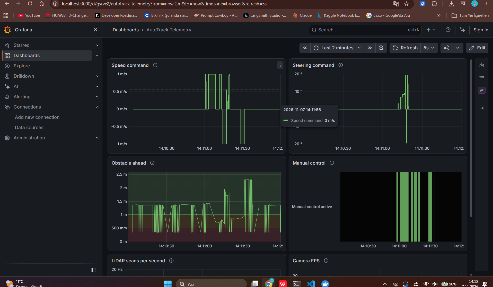
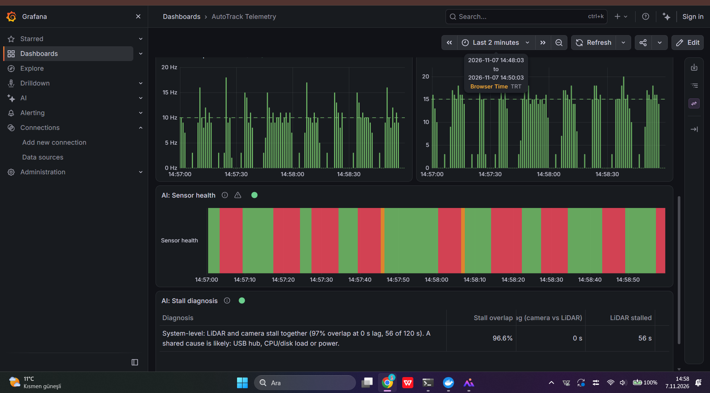
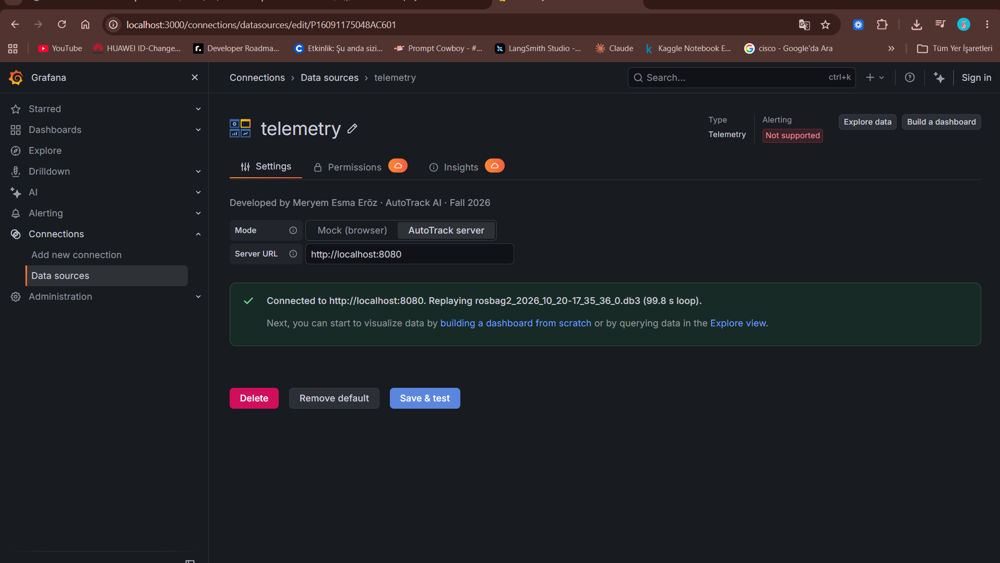
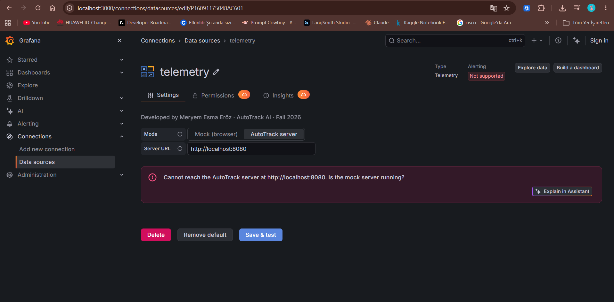
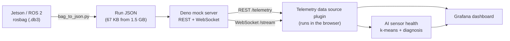

# AutoTrack AI – Grafana Telemetry Plugins

SEN0415 Advanced Web Programming · İstanbul Kültür University · Fall 2026

Grafana plugins that turn the telemetry of **AutoTrack AI**, our NVIDIA Jetson-based autonomous vehicle
(F1TENTH / ROS 2), into live dashboards. Real driving data recorded on the car is replayed by a small
server, streamed into Grafana over REST and WebSocket, and analysed in the browser by an AI module that
diagnoses sensor dropouts.

## Group

| Member | Plugin | Type |
|---|---|---|
| Meryem Esma Eröz | [`autotrack-telemetry-datasource`](plugins/autotrack-telemetry-datasource) | Data source |
| Şevval Boyraz | `autotrack-lane-panel` | Panel |
| Meryem Betül Abdulrahman | `autotrack-debug-panel` | Panel |

Each plugin shows its developer's name in its UI. The rest of this README documents the data source plugin
and the shared infrastructure (mock server, data pipeline, dashboard).

## Screenshots

**Dashboard with real driving data, live over WebSocket**



**AI sensor health analysis and diagnosis**



**Data source settings with the developer's name, and error handling when the server is down**

| Connected | Server unreachable |
|---|---|
|  |  |

## Architecture



1. **Recording.** A manual drive is recorded on the Jetson with `ros2 bag record`.
2. **Conversion.** `mock-server/tools/bag_to_json.py` reads the bag directly (no ROS installation and no
   `metadata.yaml` needed) and extracts per-signal time series: joystick speed and steering commands,
   manual-control state, nearest obstacle ahead from the LiDAR, LiDAR scan rate and camera frame rate.
3. **Replay server.** `mock-server/server.ts` (Deno) loops the recorded run, aligned to wall-clock time,
   so Grafana sees it as live data. This also covers AutoTrack requirement FR-28 (replay of recorded runs).
4. **Data source plugin.** Fetches history over REST, appends new points pushed over WebSocket, and runs
   the AI analysis in the browser.

## Quick start

Requirements: Docker (Docker Desktop on Windows/macOS), Node.js 20 or newer, Git.
On Windows, run everything inside WSL 2 (Ubuntu) and keep the repository in the Linux home directory.

```bash
git clone https://github.com/sevvalingg/advanceweb.git
cd advanceweb/plugins/autotrack-telemetry-datasource
npm install
npm run build          # or: npm run dev   (rebuilds on every change)
docker compose up -d   # starts Grafana and the mock server
```

Open <http://localhost:3000>. The `telemetry` data source and the **AutoTrack Telemetry** dashboard are
provisioned automatically. Stop everything with `docker compose down`.

| Service | Address |
|---|---|
| Grafana | <http://localhost:3000> |
| Mock server | <http://localhost:8080> |

## The data source plugin

**Settings** (Connections → Data sources → telemetry)

| Option | Values |
|---|---|
| Mode | **Mock (browser)**: synthetic signals generated in the browser · **AutoTrack server**: real recorded runs |
| Server URL | Address of the mock server as seen from the browser, default `http://localhost:8080` |

**Query editor**

| Parameter | Description |
|---|---|
| Topic | Signal to query. In server mode the list is loaded from the server's `/topics` endpoint, plus the two AI topics |
| Live | Server mode: stream new points over WebSocket instead of polling |
| Interval (ms) | Mock mode: sampling interval |

**Topics from the recorded run**

| Topic | Unit | AutoTrack requirement |
|---|---|---|
| Speed command | m/s | NFR-04 software speed limit (1 m/s) |
| Steering command | ° | FR-02 calibrated steering |
| Manual control active | on/off | FR-03 manual takeover (deadman button) |
| Obstacle ahead | m | FR-22 obstacle detection |
| LiDAR scans per second | Hz | WP1 LiDAR timeouts |
| Camera frames per second | FPS | NFR-02 (15 FPS or more) |
| AI: Sensor health timeline | state | AI section |
| AI: Stall diagnosis | table | AI section |

**Error handling.** "Save & test" calls `/health`. If the server cannot be reached the plugin shows
*"Cannot reach the AutoTrack server at … Is the mock server running?"*; unknown topics return the server's
error message (e.g. `404: Unknown topic`); a dropped WebSocket stream is reported in the panel.

## Mock server API

| Endpoint | Description |
|---|---|
| `GET /health` | Status, name of the replayed recording, loop length |
| `GET /topics` | Available topics with label and Grafana unit |
| `GET /telemetry?topic=&from=&to=&maxPoints=` | Points of one topic in a time range (epoch ms), downsampled to `maxPoints` |
| `WS /stream?topic=` | Pushes new points every 200 ms as their replay time is reached |

## AI section: sensor health analysis

The dashboard showed that the LiDAR scan rate and the camera frame rate drop to zero for several seconds,
over and over. We studied this before writing any AI code; the full study is in
[`docs/sensor-stall-analysis.md`](docs/sensor-stall-analysis.md) and can be reproduced with
`mock-server/tools/stall_analysis.py`.

**Findings on the 20 October run**

- Both sensors stall in exactly the same 37 of 100 seconds (Jaccard overlap 1.00, peak at 0 s lag).
- Both stop *producing* data: 14 gaps longer than 0.5 s in the sensors' own `header.stamp`, up to 4.9 s,
  while the recording delay never exceeds about 1 s. So the recorder is not the cause.
- Conclusion: a **system-level** problem (shared USB hub, CPU/disk load or power), not a faulty sensor.
  This is the likely root cause of the "LiDAR occasionally times out" issue noted in WP1.

**What the plugin does** ([`src/ai/sensorHealth.ts`](plugins/autotrack-telemetry-datasource/src/ai/sensorHealth.ts)),
entirely client side, on the data it receives from Grafana queries:

1. **Learns the stall threshold with 1-D k-means (k = 2)** for each sensor, instead of a hand-tuned
   value. If the data has no clearly separated low cluster (a healthy run), it reports no stalls rather
   than splitting healthy data in two.
2. **Labels every second** as healthy, camera stalled, LiDAR stalled or both stalled (state timeline).
3. **Measures the overlap** (Jaccard index) and the **lag** (−3 to +3 s) between the two sensors' stalls.
4. **Diagnoses** the cause: *system-level* (overlapping at 0 s lag), *linked* (one sensor stalls first),
   *independent* (sensor-specific) or *partly linked*.

In live mode the analysis reruns every 5 s on a sliding window. Because the learned threshold also counts
partial seconds at the edges of a dropout as stalled, the live overlap is about 95 % instead of the 100 %
found with the strict "zero messages" definition; the conclusion is the same.

**Why it matters:** a 5-second LiDAR blackout during autonomous driving would break obstacle detection.
The diagnosis points the vehicle team to concrete experiments (record without the camera, connect the
LiDAR directly to the Jetson, monitor `tegrastats`), listed in the report.

## Tests

```bash
cd plugins/autotrack-telemetry-datasource
npm run test:ci
```

7 unit tests for the AI module: k-means separation, no invented stall cluster on healthy data, empty input,
system-level diagnosis, healthy run, lag detection (LiDAR stalls 1 s before the camera) and independent stalls.

## Working with new recordings

```bash
cd mock-server
python3 -m venv .venv && source .venv/bin/activate
pip install rosbags
python tools/bag_to_json.py <recording.db3> -o data/<run>.json   # options: --steer-axis, --speed-axis, ...
python tools/stall_analysis.py <recording.db3>
```

Set `DATA_FILE` for the mock server in `docker-compose.yaml` to replay a different run.

## Repository layout

```
advanceweb/
├── docs/                                  screenshots and the sensor stall study
├── mock-server/
│   ├── server.ts                          Deno replay server (REST + WebSocket)
│   ├── data/                              converted runs (JSON)
│   └── tools/                             bag_to_json.py, stall_analysis.py
└── plugins/
    └── autotrack-telemetry-datasource/
        ├── src/
        │   ├── datasource.ts              queries, streaming, AI frames, error handling
        │   ├── ai/sensorHealth.ts         AI analysis (+ unit tests)
        │   ├── mock/telemetry.ts          synthetic signals for mock mode
        │   └── components/                ConfigEditor, QueryEditor
        ├── provisioning/                  data source and dashboard provisioning
        └── docker-compose.yaml            Grafana + mock server
```

## Known limitations

- The recorded run has no VESC data, so battery voltages exist only in mock mode. Future recordings will
  include `/drive` and `/sensors/core`.
- The steering axis of the joystick (axis 0) was inferred from the recording and is still being confirmed
  with the driver; it can be changed with `--steer-axis`.
- The scaffold's Playwright end-to-end tests in `tests/` still target the original example fields.

## Bonus claims

| Category (from the assignment) | What we did |
|---|---|
| Datasource add | New data source plugin |
| Datasource ops | REST data source, topic discovery, time-series conversion, error handling (unreachable server, unknown topic, dropped stream) |
| Datasource usage | Provisioned dashboard built on the data source |
| WebSocket | Live streaming from `/stream`, live dashboard (`liveNow`) |
| AI | Client-side sensor health analysis: k-means thresholds, joint health timeline, overlap/lag diagnosis, backed by a reproducible study |
| Test | 7 unit tests (`npm run test:ci`) |
| GitHub | Public repository |
| Documentation | This README and `docs/sensor-stall-analysis.md` |
| YouTube | Demo video: *link will be added* |
| Very big bonus | Real data from our own autonomous vehicle; the analysis found the likely root cause of a real hardware issue |

## Demo video

*Link will be added.*
